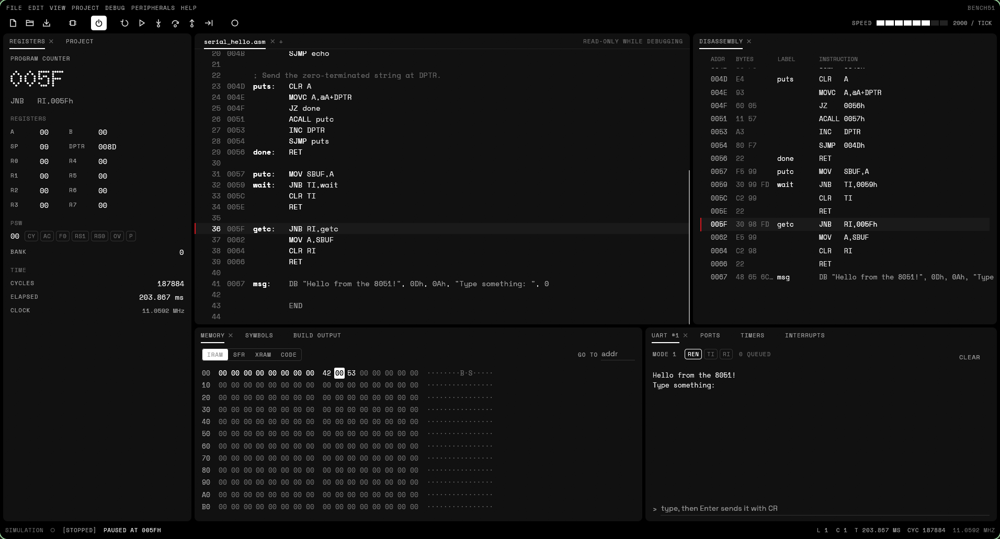
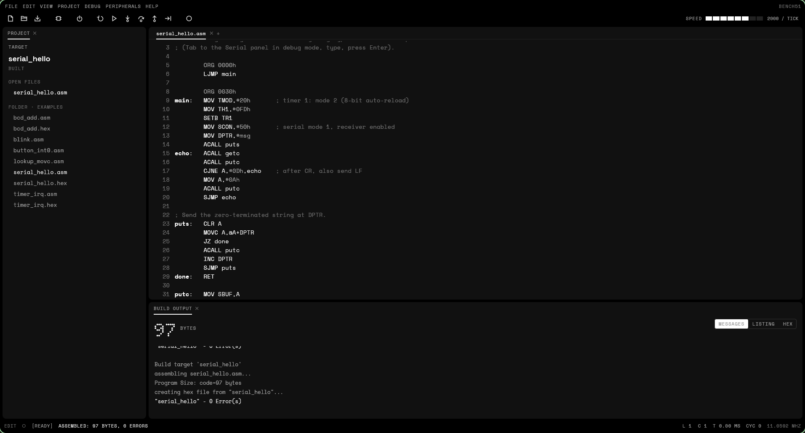
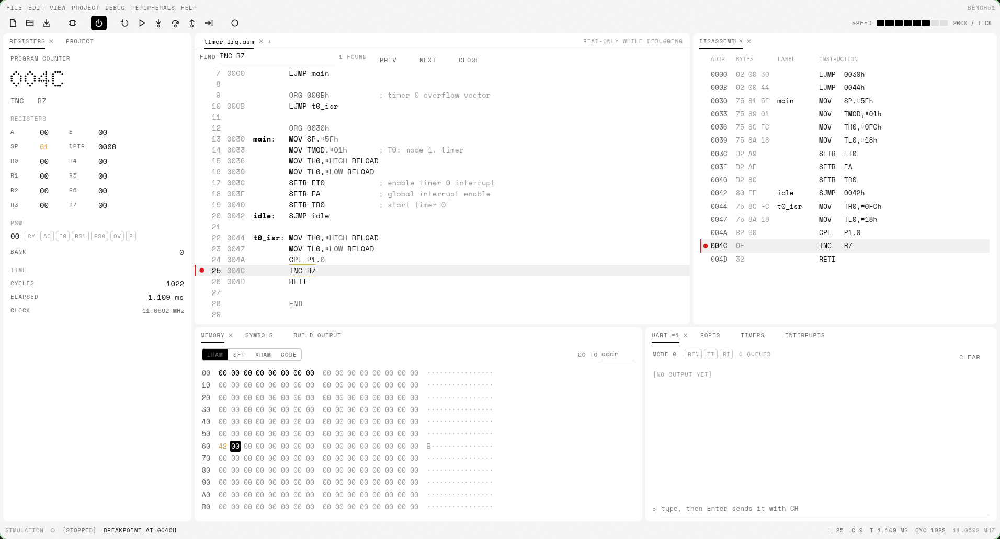
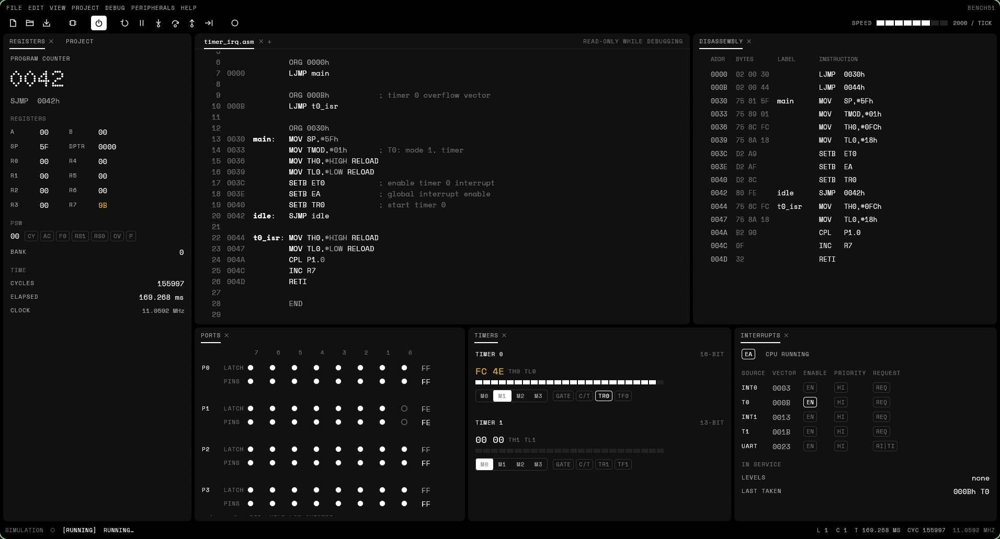
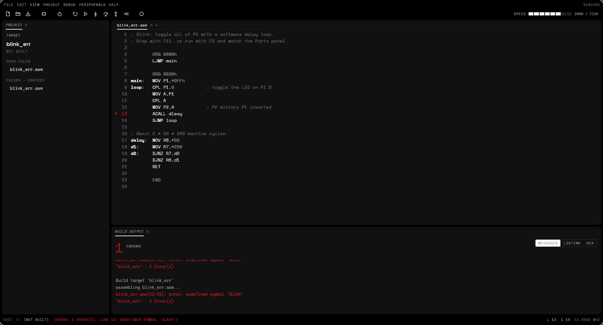
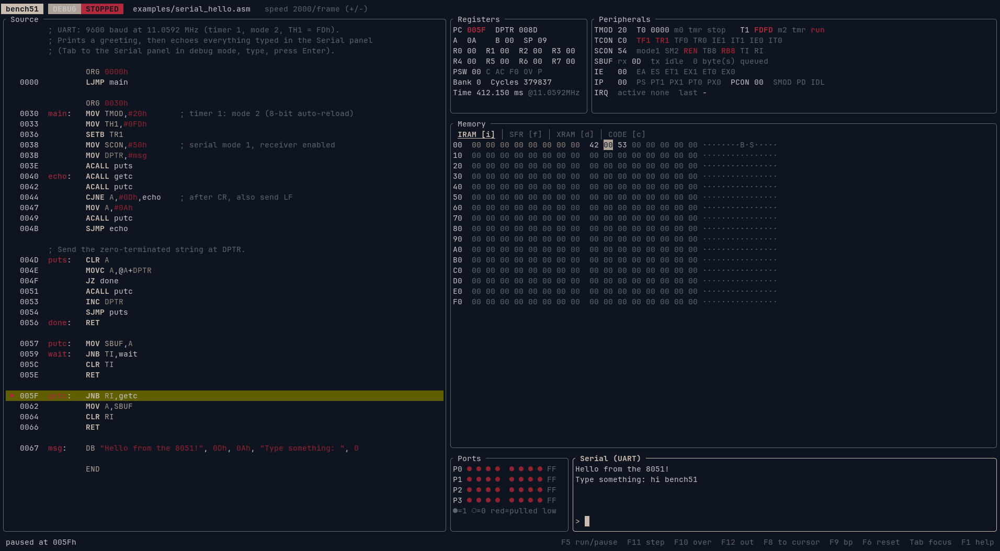
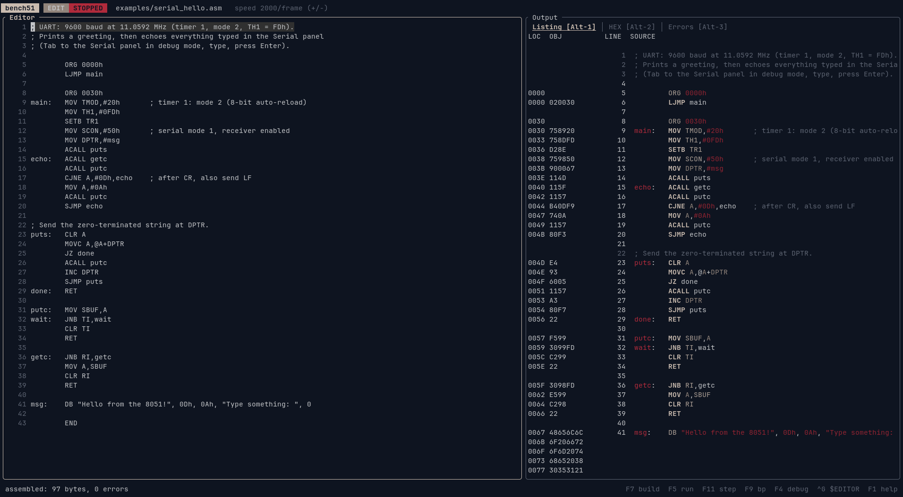
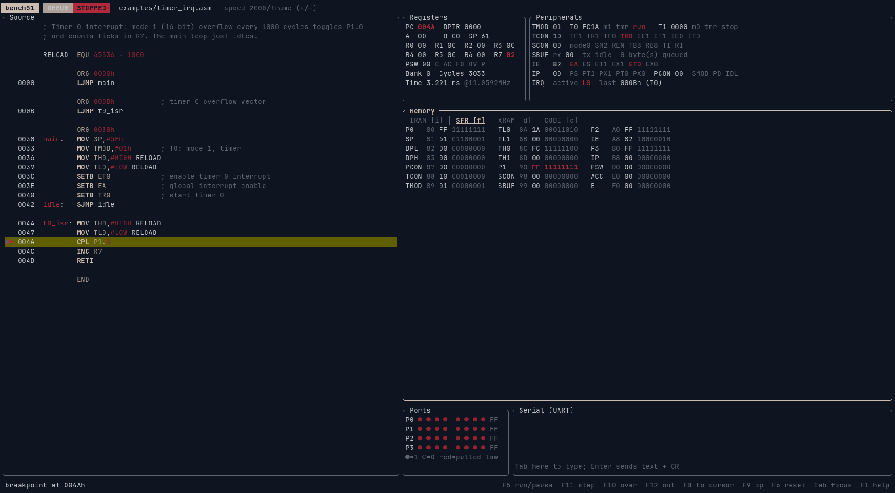
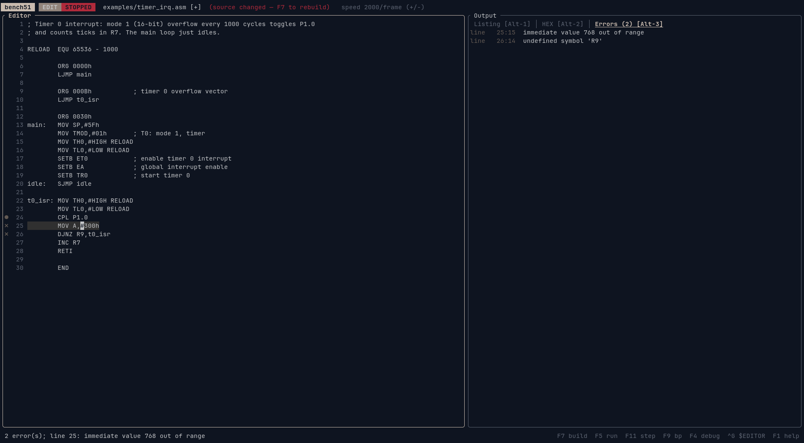
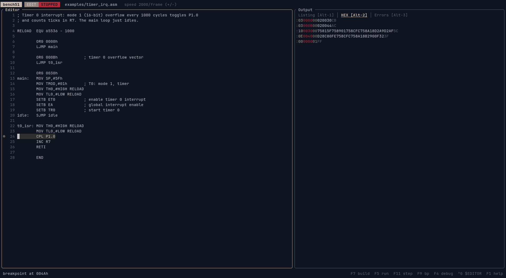

# bench51 — an 8051 assembler, simulator & debugger

[](https://github.com/krolyxon/bench51/actions/workflows/ci.yml)
[](Cargo.toml)
[](https://github.com/krolyxon/bench51)
[](crates)
[](Cargo.toml)
[](LICENSE)
[](#usage)
[](https://en.wikipedia.org/wiki/Intel_8051)
[](https://github.com/emilk/egui)
[](https://ratatui.rs)
[](https://github.com/krolyxon/bench51/commits)

A small, Keil µVision-style IDE for the Intel 8051. Write assembly in the
editor, build it, inspect the listing and Intel HEX output, then run, pause
and single-step the program while watching registers, SFRs, memory, ports,
timers, interrupts and the serial port, all in a window laid out like
µVision.

Like Emacs, it also runs in a terminal: the same assembler and simulator
come with a TUI (`bench51`) for SSH sessions and terminal setups.

Built in Rust with [egui](https://github.com/emilk/egui) and
[ratatui](https://ratatui.rs). It is a learning tool, not a cycle-exact
replacement for a vendor simulator.



<table>
  <tr>
    <td width="50%"></td>
    <td width="50%"></td>
  </tr>
  <tr>
    <td align="center"><sub>Editor + build output</sub></td>
    <td align="center"><sub>Breakpoint in a timer ISR, light theme</sub></td>
  </tr>
  <tr>
    <td width="50%"></td>
    <td width="50%"></td>
  </tr>
  <tr>
    <td align="center"><sub>Peripheral windows, rearranged</sub></td>
    <td align="center"><sub>Assembler errors</sub></td>
  </tr>
</table>

## Why this exists

I had microcontroller practicals to get through, and the course expects you to
use Keil µVision. Keil µVision doesn't run on Linux. Rather than fight with
Wine or a Windows VM every lab session, I wrote my own: bench51 does the parts
of µVision those practicals actually need (write the code, assemble it, look
at the listing and HEX, step through it and watch the registers) natively on
Linux, in a window or right in the terminal.

-----

## Features

- **µVision layout**: menus and toolbar, a Project window, the editor, Build
  Output, and in a debug session the Registers, Disassembly, Memory, Symbols,
  UART #1, Ports, Timers and Interrupts windows. Every window docks and tabs
  wherever you drag it; the edit and debug layouts are remembered separately,
  as in µVision.
- **Editor** with syntax highlighting, undo/redo, find, and breakpoint, error
  and PC markers in the gutter.
- **Two-pass assembler** for the full 8051 instruction set (all 255 opcodes):
  - labels, expressions (`+ - * / MOD AND OR XOR NOT SHL SHR HIGH LOW`, `$`)
  - number formats `42`, `2Ah`, `0x2A`, `101010b`, `52o`, `'*'`
  - bit addressing (`P1.3`, `ACC.7`, `20h.0`) and all predefined SFR/bit names
  - directives `ORG DB DW DS END EQU SET BIT DATA IDATA XDATA CODE CSEG AT`
  - generic `JMP`/`CALL` (assembled as `LJMP`/`LCALL`)
  - Keil-style `.lst` listing with symbol table, Intel HEX output
- **Simulator**
  - all instructions with correct flags (CY, AC, OV, P) and machine-cycle counts
  - 4 register banks, 256 bytes IRAM, SFRs, 64K code, 64K XRAM
  - ports P0–P3 with latch vs. pin semantics (read-modify-write reads the latch)
  - timers 0/1 in modes 0–3, gate and counter inputs
  - interrupts: INT0, T0, INT1, T1, serial; two priority levels; edge/level triggers
  - UART in modes 0–3 with baud rate timing from timer 1
  - idle and power-down modes (PCON)
- **Debugger**: run / pause, step into / over / out, run to cursor,
  breakpoints, changed-value highlighting, memory poke, adjustable speed.
- **Open `.hex` files**: they're disassembled into editable source that
  re-assembles to the identical image.
- **Dark and light themes** in a monochrome, dot-matrix design (Space
  Grotesk, Space Mono and Doto, bundled).

## Usage

```bash
cargo install --path crates/bench51-gui                  # installs `bench51-gui`

cargo run --release -p bench51-gui                        # welcome screen
cargo run --release -p bench51-gui -- examples/*.asm      # open several files
cargo run --release -p bench51-gui -- firmware.hex        # disassemble & debug a HEX file
cargo run --release -p bench51-gui -- --theme light
```

`--theme system|dark|light` overrides the theme chosen in View → Theme, and
`--clock <MHz>` the Xtal set in Project → Options for Target (default
11.0592), which is used for the elapsed-time display.

On Linux it runs on Wayland and X11 and uses the XDG desktop portal for file
dialogs. To add it to your application launcher:

```bash
install -Dm644 crates/bench51-gui/assets/bench51-gui.desktop ~/.local/share/applications/bench51-gui.desktop
install -Dm644 crates/bench51-gui/assets/bench51-gui.svg ~/.local/share/icons/hicolor/scalable/apps/bench51-gui.svg
```

It also builds for Windows and macOS. On Debian or Ubuntu, first install the
packages egui needs: `libxcb-render0-dev libxcb-shape0-dev
libxcb-xfixes0-dev libxkbcommon-dev libssl-dev`.

## Keys

The keys are µVision's, with the TUI's as aliases:

| Key | Action |
| --- | --- |
| F7 | build target (also writes `.lst` and `.hex` next to a saved file) |
| Ctrl-F5 / F4 | start / stop the debug session |
| F5 | run / stop |
| F11 / F10 | step into / step over |
| Ctrl-F11 / F12 | step out |
| Ctrl-F10 / F8 | run to the cursor line |
| F9 / Ctrl-Shift-F9 | toggle breakpoint / remove all breakpoints |
| F6 | reset the CPU |
| Ctrl-N / Ctrl-O / Ctrl-S / Ctrl-W | new / open / save / close |
| Ctrl-F | find |
| F1 | all shortcuts |

Click the gutter to toggle a breakpoint, double-click a byte in Memory to
change it, click a pin in Ports to hold it low from outside, and click the
bit chips in Registers, Timers and Interrupts to flip SFR bits. Files can be
dropped onto the window.

## Terminal version

`bench51` is the same IDE in a terminal, the way `emacs -nw` is Emacs
without a window. It has the editor, listing, HEX and error views, and a
debug screen with registers, peripherals, memory, ports and the UART. The
same binary also assembles headlessly, which is handy in scripts and
Makefiles.



<table>
  <tr>
    <td width="50%"></td>
    <td width="50%"></td>
  </tr>
  <tr>
    <td align="center"><sub>Editor + assembled listing</sub></td>
    <td align="center"><sub>Breakpoint inside a timer ISR, SFR view</sub></td>
  </tr>
  <tr>
    <td width="50%"></td>
    <td width="50%"></td>
  </tr>
  <tr>
    <td align="center"><sub>Assembler errors in the gutter and Errors tab</sub></td>
    <td align="center"><sub>Intel HEX output</sub></td>
  </tr>
</table>

```bash
cargo install --path .                               # installs the `bench51` binary

cargo run --release -- examples/serial_hello.asm      # open in the TUI
cargo run --release                                   # start with a template
cargo run --release -- firmware.hex                   # disassemble & debug a HEX file

# Headless assembly: writes prog.hex and prog.lst
cargo run --release -- --assemble prog.asm
cargo run --release -- --assemble prog.asm -o out.hex --lst out.lst
```

`--clock <MHz>` sets the oscillator frequency used for the elapsed-time display
(default 11.0592).

### Terminal keys

| Key | Action |
| --- | --- |
| F1 | help |
| F2 / Ctrl-S | save (assembling a saved file also writes `.lst` and `.hex` next to it) |
| F3 / Ctrl-O | open `.asm` or `.hex` |
| Ctrl-G | edit in `$EDITOR`; on save & exit the buffer reloads and reassembles |
| F4 | switch Edit ⇄ Debug |
| F7 | assemble, reset and load |
| F5 | run / pause (assembles first if the source changed) |
| F11 / F10 / F12 | step into / step over / step out |
| F8 | run to cursor |
| F9 | toggle breakpoint on the cursor line |
| F6 | reset |
| Ctrl-Q | quit |

Edit mode: `Alt-1/2/3` switch between Listing, HEX and Errors; `Alt-↑/↓`,
`Alt-PgUp/PgDn` scroll them. The editor uses Emacs-style keys
(`Ctrl-U` undo, `Ctrl-R` redo, `Ctrl-Y` paste), or press Ctrl-G to edit in
your own `$EDITOR` (vim, nvim, nano, …).

Debug mode: `Tab` cycles focus between Source, Memory, Ports and Serial.
Letter shortcuts work too, for terminals that swallow function keys:
`r` run/pause, `s` step, `n` step over, `o` step out, `g` run to cursor,
`b` breakpoint, `x` reset, `i`/`f`/`d`/`c` show IRAM/SFR/XRAM/CODE,
`p` poke memory, `+`/`-` speed, `.` jump to PC, `Esc` pause / back to editor.

- **Ports**: select a pin and press Space to pull it low from outside (a
  button press); the program sees the pin as `latch AND external level`.
- **Serial**: type a line and press Enter to send it (followed by CR) to the
  8051's receiver; everything the 8051 transmits appears above.

## Examples

| File | Shows |
| --- | --- |
| `examples/blink.asm` | port toggling, delay loops, `ACALL`/`RET` |
| `examples/timer_irq.asm` | timer 0 mode 1 interrupt |
| `examples/serial_hello.asm` | UART setup, string output with `MOVC`, echo |
| `examples/button_int0.asm` | edge-triggered INT0, idle mode |
| `examples/bcd_add.asm` | `ADDC` and `DA A` with packed BCD |
| `examples/lookup_movc.asm` | 7-segment table lookup |

## Notes and limitations

- Indirect addressing reaches all 256 bytes of IRAM (8052-style upper 128).
- Serial input has no 9th data bit; in modes 2/3 `RB8` reads 0.
- No 8052 timer 2, external code memory or on-chip peripherals of derivatives.

## Development

```bash
cargo test --workspace     # assembler, CPU, peripheral, session and example-program tests
cargo clippy --workspace --all-targets
```

Code layout:

- `crates/bench51-gui/` is the `bench51-gui` desktop app (egui).
- `src/` is the `bench51` terminal app (ratatui), including headless
  assembly.
- `crates/bench51-core/`, shared by both: `isa.rs` (opcode table), `asm/`
  (assembler, listing, Intel HEX), `sim/` (CPU, peripherals, disassembler),
  `session.rs` (build, run, step and breakpoints), `syntax.rs`
  (highlighting tokens), `files.rs` (HEX loading)
